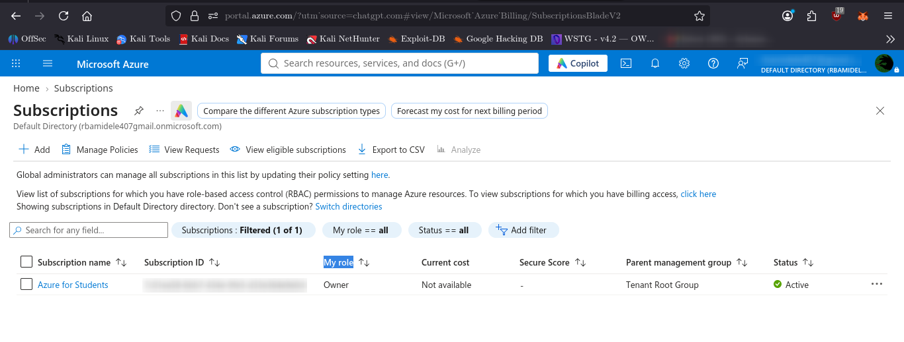
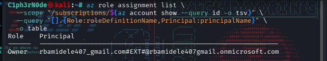

# Account Setup

## Objective

Establish and document the initial Azure security baseline for the Azure for Students subscription used for this lab.

This stage confirms the active subscription, administrative access, Azure environment, and initial privilege state before implementing additional security controls.

## Azure Environment

| Item | Value |
|---|---|
| Cloud platform | Microsoft Azure |
| Subscription | Azure for Students |
| Subscription state | Enabled |
| Directory | Default Directory |
| Identity platform | Microsoft Entra ID |
| Access control model | Azure RBAC |

## Administrative Access

The authenticated Azure identity currently has the `Owner` role assigned at the subscription scope.

The Owner role provides broad administrative permissions, including the ability to manage Azure resources and assign access to other identities.

This level of access is being treated as privileged administrative access and will be reviewed during the least-privilege stage of the assessment.

## Evidence

### Subscription Baseline

The Azure for Students subscription was confirmed to be enabled, with the current identity holding administrative access.

### Subscription-Level RBAC

Azure CLI confirmed that the authenticated identity has the `Owner` role at the subscription scope.

## Initial Security State

At the beginning of the assessment, the authenticated identity has broad administrative privileges through the Azure `Owner` role at subscription scope.

This state establishes the initial privilege baseline. Least-privilege requirements and the need for more narrowly scoped roles will be assessed in Stage 3.

## Limitations

This assessment is performed using an Azure for Students subscription. Some Azure features, administrative capabilities, or billing controls may be limited by the subscription type.

Where a control cannot be implemented or fully validated because of subscription limitations, the limitation will be documented rather than treated as successfully implemented.

## Conclusion

The Azure for Students subscription was successfully identified and validated as the active environment for this assessment. The initial administrative state was also verified through Azure RBAC.

The environment is ready for the next stage of the assessment: privileged administrative security.
