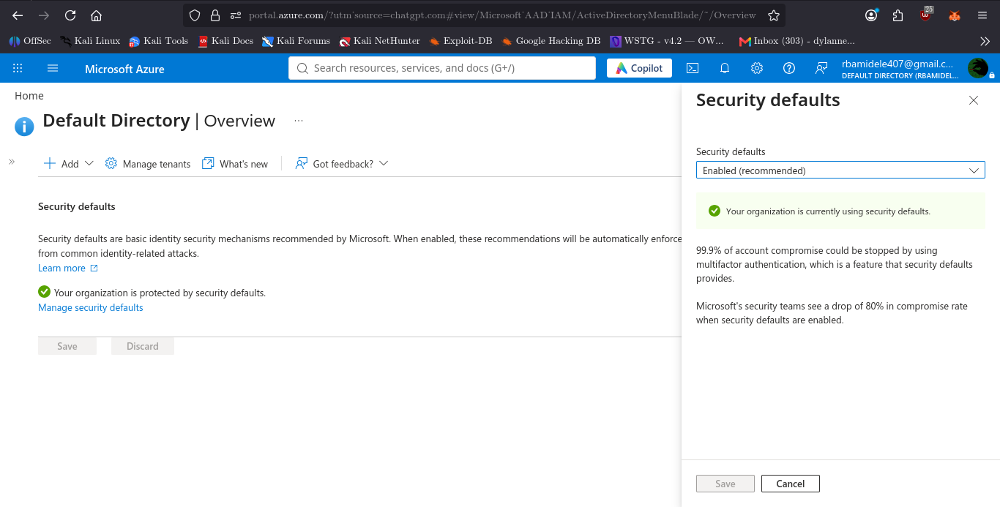

# Admin Security

## 1. Objective

The objective of this stage is to assess the security of the privileged administrative identity associated with the Azure subscription and verify whether Microsoft Entra security defaults are enabled.

Unlike AWS, Azure does not use an AWS-style root account. Administrative access is managed through Microsoft Entra ID identities and Azure Role-Based Access Control (RBAC).

## 2. Environment

| Item | Observed state |
|---|---|
| Identity provider | Microsoft Entra ID |
| Directory | Default Directory |
| License | Microsoft Entra ID Free |
| Administrative role | Owner |
| Role scope | Azure subscription |
| Security Defaults | Enabled |

## 3. Administrative Identity

The account used to manage the Azure for Students subscription has the **Owner** role at subscription scope.

The Owner role provides broad administrative permissions, including the ability to manage Azure resources and assign access to other identities.

Because this is a highly privileged identity, protecting its authentication is important.

## 4. Security Defaults

Microsoft Entra Security Defaults were inspected through:

**Microsoft Entra ID → Properties → Manage security defaults**

The portal confirmed:

> Your organization is protected by security defaults.

Security Defaults provide Microsoft's baseline identity security protections, including MFA-related requirements and blocking legacy authentication.

**Observed result:** Enabled.

### Evidence

## 5. Authentication Methods

The account's Security Info page was inspected.

The following was observed:

- Email-based one-time password (OTP) was listed.
- Microsoft Authenticator registration was not confirmed.
- The available information did not establish whether the account had completed all required MFA registration steps.

Email OTP registration should not be treated as proof that a qualifying MFA method is registered.

**Assessment status:** Further verification required.

## 6. Security Assessment

| Security control | Result |
|---|---|
| Privileged identity identified | Verified |
| Subscription Owner role identified | Verified |
| Security Defaults enabled | Verified |
| Email OTP observed | Verified |
| Authenticator registration | Not verified |
| Individual MFA registration completion | Not verified |

## 7. Limitations

This assessment was performed using an Azure for Students subscription and a Microsoft Entra ID Free tenant.

The assessment did not independently verify every authentication requirement or test every MFA challenge.

No authentication methods were removed or modified during this inspection.

## 8. Conclusion

Microsoft Entra Security Defaults are enabled in the assessed tenant, providing an important baseline identity security control.

The administrative identity holds the Owner role at subscription scope, making account protection particularly important.

Further verification of individual MFA registration is recommended before declaring the administrative identity's MFA configuration fully compliant.

**Stage 2 status:** Security Defaults verified; individual MFA registration requires further verification.
