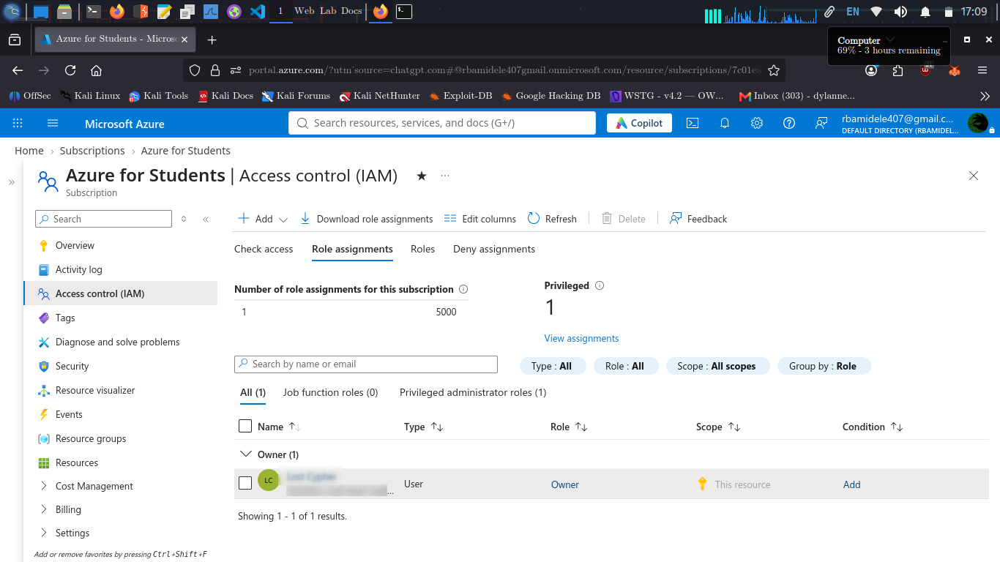
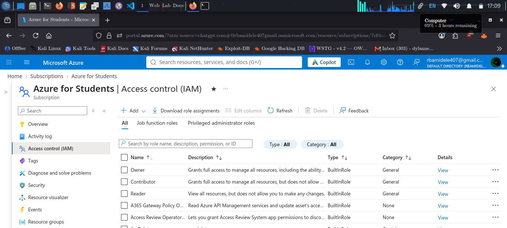
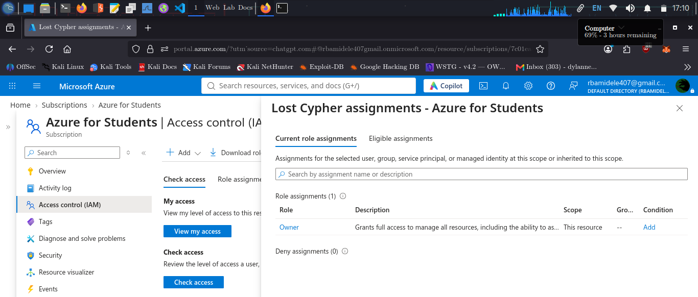

# IAM Least Privilege — Azure RBAC

## 1. Objective

The objective of this stage is to inspect Azure access permissions, understand role assignments, and evaluate how the principle of least privilege applies to the Azure environment.

Azure uses Role-Based Access Control (RBAC) to manage access to resources.

## 2. Azure RBAC Fundamentals

Azure RBAC access decisions involve three main components:

| Component | Description |
|---|---|
| Security principal | The user, group, managed identity, or service principal receiving access |
| Role definition | The permissions granted to the security principal |
| Scope | The level at which permissions apply |

## 3. Role Definitions

The following built-in roles were included in the role inspection:

| Role | Purpose |
|---|---|
| Owner | Full resource management and permission assignment |
| Contributor | Resource management without permission assignment |
| Reader | View resources without modifying them |

Additional role definitions were visible in the Azure portal.

## 4. Scope Hierarchy

Azure RBAC supports different assignment scopes:

1. Management group
2. Subscription
3. Resource group
4. Individual resource

Permissions assigned at a higher scope can be inherited by lower scopes.

## 5. Access Review

The Azure portal Access Control (IAM) interface was inspected.

The following areas were reviewed:

- My access
- Check access
- Role assignments
- Roles
- Deny assignments

The Azure CLI was also used to retrieve role assignment information.

Command used:

```bash
az role assignment list \
  --all \
  --query "[].{Role:roleDefinitionName,Principal:principalName,Type:principalType,Scope:scope}" \
  -o table
```

This command provides a structured view of role assignments, including the assigned role, principal type, and scope.

## 6. Evidence

### Role Assignments



### Role Definitions



### My Access



## 7. Least Privilege Recommendations

The following recommendations apply to the assessed environment:

- Assign permissions according to actual job responsibilities.
- Avoid unnecessary Owner assignments.
- Use Reader access for users who only need visibility.
- Use Contributor where resource management is required without access administration.
- Prefer resource-group or resource-level assignments when subscription-wide access is unnecessary.
- Review privileged assignments periodically.
- Use groups where appropriate to simplify access administration.

## 8. Assessment Limitations

This review inspected Azure RBAC role definitions and assignments.

The inspection did not include a complete review of every application permission, managed identity, service principal, or inherited access path.

No existing permissions were modified or removed during this assessment.

## 9. Conclusion

Azure RBAC provides a structured mechanism for controlling access through roles and scopes.

The portal and Azure CLI were used to inspect the available role definitions and assignments.

The findings provide a baseline for future access reviews and least-privilege improvements.

**Stage 3 status:** RBAC inspection completed. No permission changes performed.
