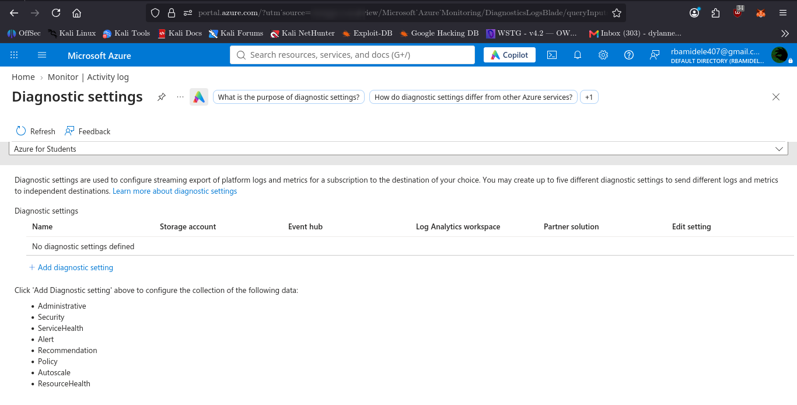

# 04 — Azure Activity Log

## Objective
Inspect Azure subscription-level activity logging and determine whether events are available and whether log export is configured.

## Environment
- Cloud provider: Microsoft Azure
- Subscription: Azure for Students
- Logging service: Azure Monitor Activity Log

## Activity Log Inspection
The Activity Log was inspected using the Azure Portal with the time range set to the last seven days.

**Observation:** No events were visible for the selected subscription during the inspection period.

## Diagnostic Settings
The subscription's Diagnostic Settings page was inspected.

**Finding:** No diagnostic settings were defined.

The available export categories include:
- Administrative
- Security
- ServiceHealth
- Alert
- Recommendation
- Policy
- Autoscale
- ResourceHealth

No export destination was configured.

## CLI Validation
The following Azure CLI command was attempted:

```bash
az monitor activity-log list --offset 7d --max-events 10 \
  --query "[].{Event:operationName.localizedValue,Status:status.localizedValue,Time:eventTimestamp,Category:category.localizedValue}" \
  -o table
```

The command failed while loading the Azure CLI Monitor module due to a local Python dependency compatibility error (`ord() expected string of length 1, but int found`).

This was recorded as a local tooling limitation, not evidence of an Azure service failure.

## Security Assessment
- Activity Log inspection: Completed
- Events observed: None
- Diagnostic export: Not configured
- Long-term centralized log analysis: Not configured

## Recommendations
1. Configure diagnostic settings when an appropriate destination is available.
2. Consider exporting Administrative, Security, ServiceHealth, and Policy events.
3. Use Log Analytics or secure Storage for centralized retention, subject to available student credits and costs.
4. Periodically review subscription activity for unexpected privileged operations.

## Conclusion
The Azure Activity Log service was inspected successfully through the portal. No events were visible during the selected seven-day period, and no diagnostic export configuration existed. Further centralized monitoring can be implemented when an appropriate destination is available.
