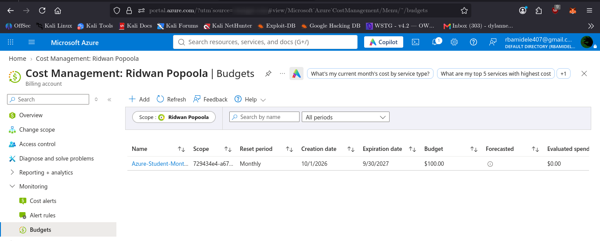

# 05 — Azure Billing Alerts and Budget Monitoring

## Objective
Configure a monthly Azure budget and spending alerts to monitor student subscription credit usage.

## Environment
- Cloud provider: Microsoft Azure
- Subscription plan: Azure for Students
- Service: Azure Cost Management
- Budget scope: Ridwan Popoola

## Budget Configuration

A monthly budget was successfully created with the following settings:

| Setting | Configuration |
|---|---|
| Budget name | Azure-Student-Monthly-Budget |
| Reset period | Monthly |
| Budget amount | $100 |
| Creation month | October 2026 |
| Expiration date | September 30, 2027 |

## Alert Configuration

Three actual-cost alert thresholds were configured:

| Threshold | Alert amount |
|---|---:|
| 50% | $50 |
| 80% | $80 |
| 100% | $100 |

Email notifications were configured for the budget alerts.

## Evidence

## Security and Cost Management Assessment

The subscription previously had no budgets configured.

A monthly budget and three alert thresholds were successfully created to improve spending visibility and provide notifications as costs increase.

**Important limitation:** Azure budgets are monitoring and notification controls. They do not automatically stop resource deployment or prevent spending beyond the configured amount.

## Conclusion

A monthly $100 Azure budget was successfully configured with 50%, 80%, and 100% actual-cost alerts. This establishes a basic cost-monitoring control for the Azure student environment.
