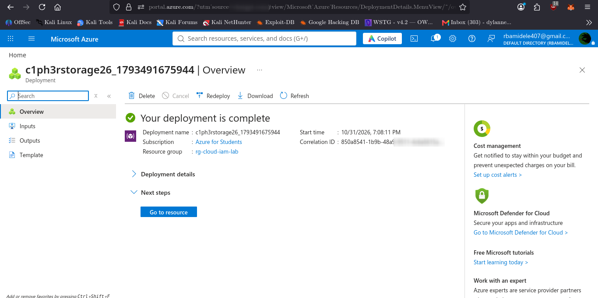
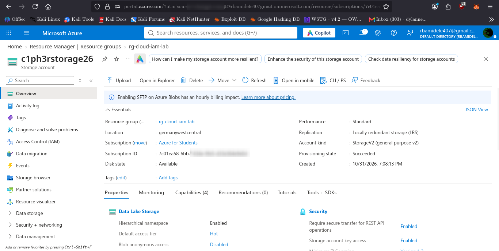
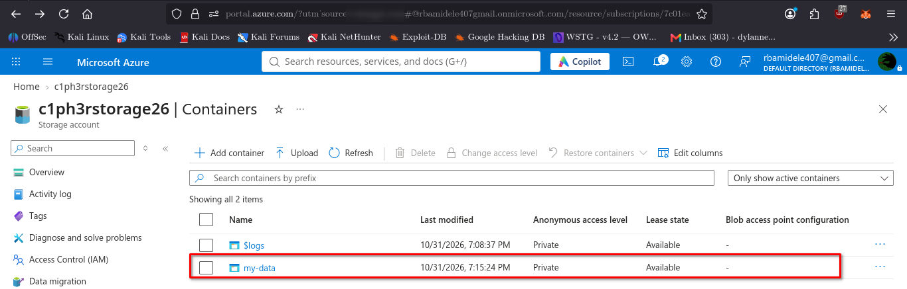

# 06 — Azure Storage Protection

## Objective

Deploy and secure an Azure Storage Account using Microsoft-recommended security controls to protect stored data against unauthorized access.

## Environment

- Cloud provider: Microsoft Azure
- Subscription: Azure for Students
- Resource group: `rg-cloud-iam-lab`
- Storage account: `c1ph3rstorage26`
- Storage region: Germany West Central
- Storage type: Standard General-purpose v2
- Replication: Locally Redundant Storage (LRS)

## Storage Account Configuration

A new Azure Storage Account was successfully deployed with the following security settings:

| Security control | Configuration |
|---|---|
| Secure transfer required | Enabled |
| Blob anonymous access | Disabled |
| Minimum TLS version | TLS 1.2 |
| Storage account key access | Disabled |
| Hierarchical namespace | Disabled |
| SFTP | Disabled |
| Network File System v3 | Disabled |

## Network Security

Public network access was enabled with access restricted to selected virtual networks and IP addresses.

This provides a network-level restriction rather than unrestricted access from all networks.

## Data Protection

The following data protection settings were configured:

| Protection control | Configuration |
|---|---|
| Blob soft delete | Enabled |
| Blob retention | 7 days |
| Container soft delete | Enabled |
| Container retention | 7 days |
| Blob versioning | Disabled |
| Blob change feed | Disabled |

## Private Blob Container

A private Blob container named `security-evidence` was created.

Its anonymous access level was configured as:

**Private (no anonymous access).**

This prevents anonymous users from accessing container contents.

## Evidence

### Storage Account Deployment

### Storage Security Configuration

### Private Blob Container

## Security Assessment

The deployment established several important storage security controls:

1. HTTPS-only communication protects data in transit.
2. Anonymous Blob access is disabled.
3. TLS 1.2 is enforced as the minimum transport security protocol.
4. Shared key authorization is disabled, reducing reliance on account keys.
5. Private container access prevents anonymous data exposure.
6. Soft delete provides a recovery window for deleted blobs and containers.

## Limitations

- Storage account public network access remains enabled, although restricted to selected networks and IP addresses.
- Blob versioning and change feed were not enabled.
- Microsoft Defender for Storage was not enabled.
- No actual external penetration test or unauthorized-access test was performed.

## Conclusion

An Azure Storage Account was successfully deployed and configured with multiple security protections. Anonymous access and shared key access were disabled, secure transfer was enforced, and a private Blob container was created.

The configuration demonstrates the application of storage security principles, access restriction, and data protection within an Azure student subscription.
