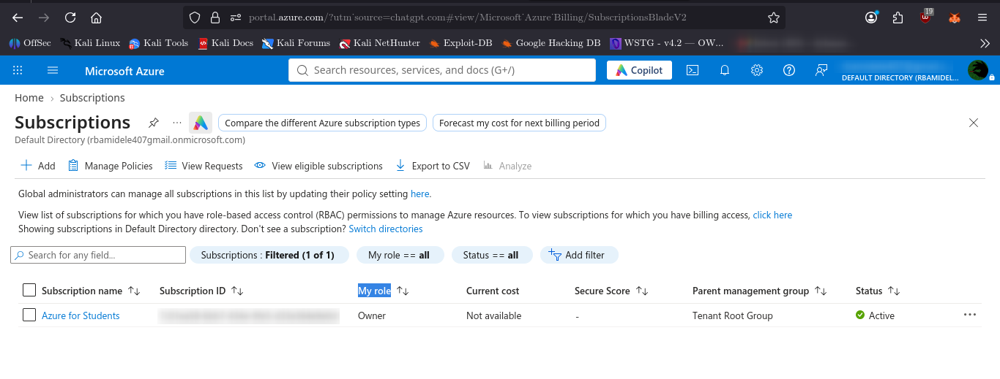
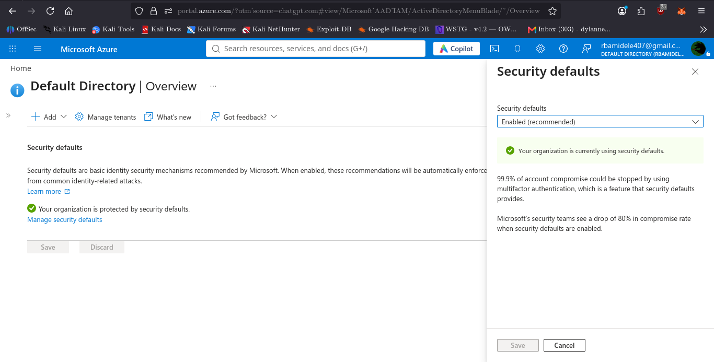
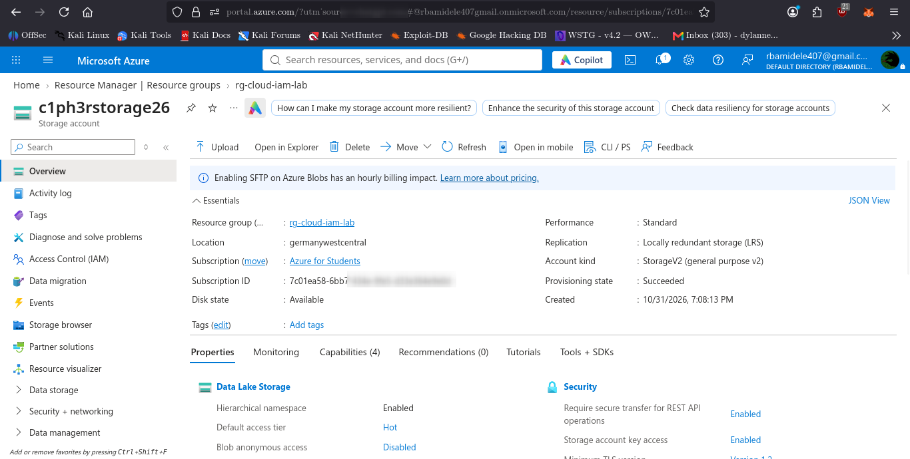
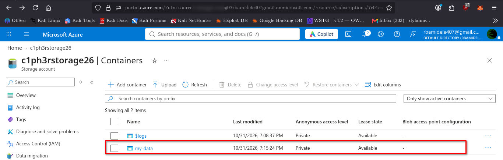

# Azure Cloud Basics and IAM

<p align="center">
  <strong>A Practical Cloud Security Configuration and Assessment Project</strong>
</p>

<p align="center">
  
  
  
  
</p>

## Overview

This project demonstrates hands-on experience with foundational cloud security concepts using **Microsoft Azure for Students**.

It focuses on securing a cloud environment through identity and access management, privileged account security, activity monitoring, cost management, and storage protection.

The project follows a practical security workflow:

**Understand → Configure → Validate → Capture Evidence → Document → Recommend Improvements**

Rather than simply deploying resources, the objective was to inspect configurations, test selected security controls, identify limitations, and document recommendations.

## Objectives

- Understand Microsoft Azure subscription and resource management.
- Review identity security using Microsoft Entra ID.
- Explore Azure Role-Based Access Control (RBAC).
- Apply least-privilege principles through custom role definition drafts.
- Review Azure Activity Log and diagnostic settings.
- Configure budget notifications.
- Protect Azure Storage against unauthorized access.
- Validate security configurations and document findings.

## Technologies and Tools

| Technology | Purpose |
|---|---|
| Microsoft Azure | Cloud platform |
| Microsoft Entra ID | Identity and account security |
| Azure RBAC | Access management |
| Azure Activity Log | Subscription activity monitoring |
| Azure Cost Management | Budget monitoring |
| Azure Blob Storage | Cloud storage |
| Azure CLI | Command-line configuration and validation |
| Kali Linux | Working environment |
| Git and GitHub | Version control and project documentation |
| JSON and Markdown | Role definitions and technical reports |

## Project Stages

| Stage | Area | Description |
|---|---|---|
| 01 | Account Setup | Created and reviewed the Azure subscription environment. |
| 02 | Admin Security | Enabled Security Defaults and reviewed account security information. |
| 03 | IAM and Least Privilege | Inspected RBAC assignments and prepared custom role definitions. |
| 04 | Activity Log | Reviewed subscription activity monitoring and diagnostic settings. |
| 05 | Billing and Alerts | Configured a monthly budget and spending notifications. |
| 06 | Storage Protection | Created a storage account and private Blob container, then reviewed security settings. |
| 07 | Validation | Evaluated implemented controls and documented limitations. |
| 08 | Final Report | Produced a consolidated cloud security assessment report. |
| 09 | Resume and Portfolio | Documented project experience and demonstrated skills. |

## Key Security Configurations

### Identity and Access Management
- Enabled Microsoft Entra Security Defaults.
- Reviewed subscription-level role assignments.
- Inspected built-in Azure role definitions.
- Prepared custom least-privilege role definition JSON drafts.

### Monitoring and Cost Management
- Reviewed Azure Activity Log.
- Inspected subscription diagnostic settings.
- Configured a monthly budget of $100.
- Set notification thresholds at 50%, 80%, and 100%.

### Storage Security

The project created an Azure Storage account and a private Blob container.

| Configuration | Observed result |
|---|---|
| HTTPS-only traffic | Enabled |
| Minimum TLS version | TLS 1.2 |
| Anonymous Blob access | Disabled |
| Shared Key authorization | Disabled |
| SFTP | Disabled |
| Container access | Private |
| Default network rule | Deny |

Additional configuration findings, including enabled hierarchical namespace, enabled NFS v3, and public network access with Azure Services bypass, are documented in the validation report.

## Evidence and Validation

Evidence is organized in the `images/` directory.

Examples include:

**Azure subscription and account setup**



**Microsoft Entra Security Defaults**



**Azure Storage configuration**



**Private Blob container**



See [`07-validation/validation.md`](07-validation/validation.md) for the detailed validation results.

## Repository Structure

```text
Azure-Cloud-Basics-and-IAM/
│
├── 01-account-setup/
├── 02-admin-security/
├── 03-iam-least-privilege/
│   └── roles/
├── 04-activity-log/
├── 05-billing-alerts/
├── 06-storage-protection/
│   └── policies/
├── 07-validation/
├── 08-report/
├── 09-resume/
├── docs/
├── images/
└── README.md
```

## Important Findings and Limitations

This project was conducted in an Azure for Students environment. Some controls were configured and verified, while others remain incomplete.

- Individual MFA registration and successful MFA completion were not independently verified.
- Custom RBAC roles were prepared as JSON drafts but were not deployed or assigned.
- Activity Log event collection was not fully validated.
- Diagnostic export was not configured.
- NFS v3 remains enabled.
- Public network access remains enabled, with the default network rule set to Deny and Azure Services bypass enabled.

These findings are documented honestly rather than presenting unverified controls as completed security improvements.

## Documentation

For detailed information,
